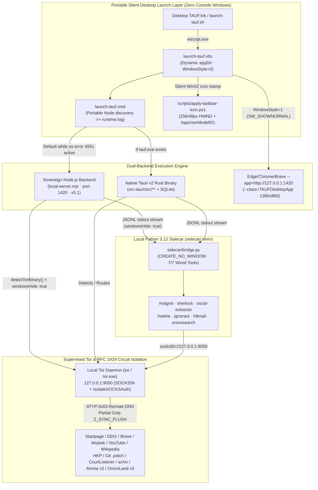

# TAUF V5.1 (`v5.1-sovereign-verified`) — Comprehensive Agent Handoff Specification

> **Repository Root:** `<REPO_ROOT>` (portable — zero hardcoded user paths)  
> **Runtime Build ID:** `v5.1-sovereign-verified`  
> **App Identifier:** `io.tauf.desktop` (`TAUFDesktopApp` / `TAUF.Desktop.Workbench`)  
> **Local Data Vault:** `%LOCALAPPDATA%\TAUF` (Windows) · `~/.tauf` (macOS/Linux)  
> **Target Audience:** AI Coding Agents & Systems Engineers inheriting TAUF for V5.2+ / V6 development.

---

## 1. Executive Overview, Core Philosophy & Hard Constraints

**TAUF** is a **sovereign, single-view, identity-driven OSINT desktop workbench** built to discover, corroborate, visualize, and export everything publicly linked to a person's name — across mainstream social media, public legal/corporate/academic records, public PDFs, contact anchors (emails & phone numbers), code repositories, cryptographic keys, offline breach corpora, and live Tor `.onion` hidden services — **running 100% locally on the operator's machine with zero external OSINT SaaS APIs**.

### 1.1 Non-Negotiable Hard Constraints (MUST NEVER BE VIOLATED)

1. **100% Zero External Paid or Free OSINT SaaS APIs & Zero API Keys:**
   - TAUF **never** calls third-party OSINT APIs, REST APIs, or commercial/free SaaS endpoints.
   - **Explicitly Forbidden Patterns:** `api.github.com`, `api.gitlab.com`, `crt.sh`, `haveibeenpwned`, `dehashed`, `hibp`, `hunter.io`, `shodan`, `censys`, `intelx`, `leakcheck`, `snusbase`, `breachdirectory`, `peopledatalabs`, `rocketreach`, `clearbit`, `fullcontact`, `pipl`, `virustotal`, `urlscan`, `securitytrails`, `whoisxml`, `abstractapi`, `numverify`, `serpapi`, `RapidAPI`, or any `/api/v1` / `/api/v2` / `api.` URL.
   - All intelligence is gathered via **direct protocol engines** (raw HTTP/HTTPS HTML fetches, RFC 4880 OpenPGP binary packet parsing, direct UDP/TCP DNS packets, direct port-443 TLS X.509 certificate handshakes, raw `.patch` / `.gpg` / `.keys` / `.atom` endpoints, direct PDF byte-range Info/XMP/text parsing, direct Tor `socks5h://` `.onion` crawling) and **7 local open-source CLI sidecar tools** executing inside `sidecar/.venv`.

2. **Name-as-Sole-Root General-Purpose Identity Graph (Zero GitHub Bias):**
   - The central root node (`layer: "seed"`, `kind: "person"`, `depth: 0`) is **strictly the exact `full_name` typed by the operator** (`normalizeNodeId("person", fullName)` -> `person:<normalized_name>`).
   - **GitHub has zero special prominence.** All branches radiate hierarchically from `seedId` across Mainstream Social (`Instagram`, `LinkedIn`, `X/Twitter`, `YouTube`, `TikTok`, `Threads`, `Facebook`, `Reddit`, `Dev.to`), Contacts (`Email`, `Phone`), Legal/Corporate/Academic Public Records (`CourtListener`, `arXiv`, `Wikipedia`), Public Documents (`PDFs`), Registered Services (`holehe`, `ignorant`), and Dark Web & Leaks (`Ahmia v3 .onion`, `OnionLand v3 .onion`, `onionsearch`, `local-corpus`, `h8mail`).
   - True multi-tier BFS branching is enforced across all engines and finalized by `ensureGraphIntegrity(snap, seedId)` (**0** self-loops, **0** broken edges, **0** orphan nodes).

3. **Strict Tor `socks5h://` Anonymity, RFC 1929 Circuit Isolation & Fail-Closed Guard:**
   - All network engines route through `socks5h://127.0.0.1:9050` (SOCKS5 with **ATYP `0x03` DOMAINNAME** remote DNS resolution at the Tor exit node — **zero local UDP DNS leakage**).
   - `openSocks5hTunnel` / `socks5hRequest` / `sovereignFetch` support optional RFC 1929 `0x02` username/password authentication (`opts.socksUser`) to leverage Tor's default `IsolateSOCKSAuth`, giving each search query its own independent Tor exit circuit and retrying `startpage` / `ddg-lite` once on a fresh circuit if an exit is rate-limited.
   - When `strict_anonymity: true` (default when Tor is available), `sovereignFetch()` and `inspectDomainDns()` enforce a **fail-closed guard**: if local Tor SOCKS5h is unreachable, TAUF **refuses all clearnet egress** (`STRICT_ANONYMITY_BLOCKED`), skips local UDP DNS queries, and runs only offline local corpus scans.
   - Never solve or bypass CAPTCHAs/anti-bot challenges: `detectSearchChallenge()` cleanly detects HTTP `202`/`403`/`429` or challenge pages, fails over to the next engine, and records honest telemetry in `web-social`.

4. **Zero-Hallucination Calibration & Live Verification Gate:**
   - Every site in `src-tauri/resources/wmn_curated.json` (**70 calibrated sites**; `Linktree` and `TryHackMe` removed) is verified against **3 synthetic random canaries** (`zqxjkvcanaryx`, `qxjv9284zpl`, `zqxjkv_canary_982741`) over live Tor with **`FALSE_POSITIVES = 0`**.
   - `BLOCKED_SPA_HOSTS` (`crates.io`, `substack.com`, `bsky.app`, `archive.org`, `500px.com`, `slideshare.net`, `thingiverse.com`, `wordpress.com`, `linktr.ee`, `tryhackme.com`, `bandcamp.com`) blocks uncalibrated SPA shells and dead 404 hosts across both `local-server.mjs` and `sidecar/bridge.py`.
   - `verifyLiveAccountUrl()` gates sidecar-emitted accounts (excluding `AUTH_WALLED_HOSTS`: `instagram.com`, `linkedin.com`, `x.com`, `twitter.com`, `facebook.com`, `threads.net`) with a bounded `sovereignFetch` (`maxBytes: 24576`, `5000ms`), rejecting HTTP 404/410, feed/asset URLs (`.atom`/`.rss`/`.xml`/`.json`/`.keys`/`.gpg`), Telegram missing-user soft-404s, Vercel checkpoints, and Reddit Tor block shells (`<title>Reddit</title>` / `<15KB` without `/u/`).

5. **Silent Zero-CMD Execution & Cross-Platform Portability:**
   - Zero hardcoded user paths across launchers, backend, sidecar, scripts, and frontend.
   - Windows Desktop shortcuts (`TAUF.lnk`) invoke `wscript.exe` targeting `launch-tauf.vbs` (dynamic `appDir` via `WScript.ScriptFullName`, `WindowStyle=0` hidden `launch-tauf.cmd`, `WindowStyle=1` Edge/Chrome/Brave `--app` with `--class=TAUFDesktopApp --app-id=TAUFDesktopApp`, silent `scripts/apply-taskbar-icon.ps1`).
   - All Node child processes pass `windowsHide: true`, all Python subprocesses pass `CREATE_NO_WINDOW`, and macOS/Linux are supported via `launch-tauf.sh`, `scripts/setup.mjs`, portable `detectTorBinary()` / `detectPythonPath()`, and cross-platform `openDesktopWindow(url)`.

6. **Windows Defender / Smart App Control Context (`os error 4551`):**
   - Never bypass or disable Windows Defender. The Tauri v2 Rust codebase (`src-tauri/src/**`) is kept `rustfmt --edition 2021 --check` clean and IPC-aligned, while `local-server.mjs` implements all 11 IPC commands, SSE streaming (`/events`), JSON vault (`%LOCALAPPDATA%\TAUF\cases.json`), supervised Tor, and the Python sidecar bridge inside a standalone chromeless browser `--app` window (`1380x860`).
   - `package.json` retains WASM overrides (`@rollup/wasm-node`, `esbuild-wasm`) so `npm run build` runs cleanly without native `.node`/`.exe` blocks.

---

## 2. Complete File & Directory Map

```text
<REPO_ROOT>/
├── index.html                              # Root HTML entry; links /favicon.ico, /logo-32.png, /logo-192.png, /manifest.webmanifest (?v=5/?v=6-aqua)
├── launch-tauf.vbs                         # Portable dynamic-appDir silent WScript launcher (zero CMD popup, polls /__tauf_health__, stamps taskbar icon)
├── launch-tauf.cmd                         # Portable Windows bootstrapper: prefers tauf.exe, else discovers Node (PATH, ProgramFiles, NVM, Volta, Scoop, fnm, fallback) -> local-server.mjs
├── launch-tauf.sh                          # Portable macOS/Linux bash launcher (LF line endings)
├── local-server.mjs                        # Sovereign V5.1 Node.js backend (~7,120 lines, build_id: "v5.1-sovereign-verified") — 18-engine pipeline, RFC 1929 SOCKS5h, partial gzip, supervised Tor, RPC + SSE
├── package.json                            # React 18, Cytoscape 3.30, Lucide, Tauri API v2, setup/start scripts + WASM rollup/esbuild overrides
├── package-lock.json                       # Locked npm dependency tree
├── tsconfig.json                           # Strict TypeScript 5.7 configuration
├── vite.config.ts                          # Vite 6 bundler configuration (port 1420, manualChunks for cytoscape & react)
│
├── scripts/
│   ├── setup.mjs                           # Cross-platform first-run verifier & installer (--check / full setup for Node, Python venv, 7 sidecars, Tor)
│   ├── generate-icons.py                   # 2048x2048 headless rasterizer generating all PNGs and 7-frame PNG-compressed ICOs
│   └── apply-taskbar-icon.ps1              # Clears browser Favicons cache, updates Desktop/OneDrive TAUF.lnk shortcuts, stamps 256/48px Win32 HWND icons & AppUserModelID
│
├── public/                                 # Static assets copied to dist/
│   ├── logo.svg                            # 512x512 Scriber-inspired beveled obsidian squircle + sculpted T monogram
│   ├── favicon.ico                         # 7-frame PNG-compressed ICO [16, 24, 32, 48, 64, 128, 256]
│   ├── logo-32.png / logo-64.png           # Crisp navbar & small-DPI PNGs
│   ├── logo.png / logo-192.png / logo-256.png / logo-512.png / logo-1024.png
│   └── manifest.webmanifest                # Web App Manifest matched 1:1 with PNG sizes
│
├── sidecar/                                # Local Open-Source Python CLI Sidecar Bridge
│   ├── bridge.py                           # Python 3.12+ parallel sidecar runner (~1,010 lines) — strictly 7/7 wired OSS tools, CREATE_NO_WINDOW, Tor socks5h://
│   ├── requirements.txt                    # Exact 7 OSS tools + socksio, requests, httpx, PySocks
│   └── .venv/                              # Self-contained Python 3.12 virtual environment
│
├── src/                                    # React 18 + TypeScript Frontend
│   ├── main.tsx                            # React DOM mount entry
│   ├── App.tsx                             # Single-view 3-zone workstation, honest offline-backend banner, 4-level depth selector, live ETA strip
│   ├── types.ts                            # Canonical TypeScript interfaces matching Rust & Node backends 1:1
│   ├── styles.css                          # Industrial dark-slate & amber UI stylesheet (responsive 1380x860 & 1024x680, non-overlapping bottom HUD & 2-row command bar)
│   ├── components/
│   │   ├── IdentityBrief.tsx               # Left Zone (272px): Target Header, 0–100 Exposure Score, 4 Metric Cells, Quick Actions, Local Engines Progress + honest challenge telemetry
│   │   ├── IdentityGraph.tsx               # Center Zone (1fr): Cytoscape.js canvas with real BFS hops (Concentric & Hierarchy), shortest-path edge relation labels, "Branched from:" tooltips, defensive self-loop filter
│   │   ├── FindingsStream.tsx              # Right Zone (430px): Contacts, Accounts, Records, Dark web tabs (rich .onion cards + broad mentions disclosure + exact tor-socks5h spam telemetry)
│   │   ├── ConfigToolsModal.tsx            # Local Environment & Tools modal (Tor endpoint, exit IP, proxy, corpus path, .onion seeds, strictly 7/7 sidecar tool badges)
│   │   └── ConfirmPurgeDialog.tsx          # Destructive case/vault purge confirmation modal
│   └── lib/
│       ├── classify.ts                     # Deterministic entity classifier, 1:1 count parity, sanitizeDisplayText() (strips CSS/HTML & decodes entities), OnionRecord & broadOnionHits split
│       ├── tauri.ts                        # Dual-mode IPC client (Native Tauri -> Local Node /rpc + /events SSE; honest offline errors, zero mock fixtures)
│       ├── redact.ts                       # Real-time PII masking utility
│       └── topLayer.ts                     # Native HTML <dialog> helper
│
└── src-tauri/                              # Native Rust Tauri v2 Backend
    ├── Cargo.toml / Cargo.lock / build.rs / tauri.conf.json
    ├── capabilities/default.json
    ├── icons/                              # 16, 32, 128, 256, 512 PNGs + 7-frame icon.ico, tauf.ico, tauf-aqua.ico
    ├── resources/wmn_curated.json          # 70-platform 3-Canary-calibrated direct-HTML WhatsMyName definitions (0 false positives)
    └── src/                                # main.rs, lib.rs, models.rs, commands.rs, db.rs, export.rs, engine/*.rs (rustfmt --check clean)
```

### 2.1 External Local Runtime Paths (Outside Repository)

| Path | Role |
|---|---|
| `%USERPROFILE%\Desktop\TAUF.lnk` / OneDrive Desktop `TAUF.lnk` | Silent Windows Desktop shortcuts (`wscript.exe` -> `launch-tauf.vbs`, icon `src-tauri\icons\tauf-aqua.ico` / `icon.ico`) |
| `%LOCALAPPDATA%\TAUF\cases.json` (`~/.tauf/cases.json`) | Local JSON case vault used by `local-server.mjs` |
| `%LOCALAPPDATA%\TAUF\config.json` | Persisted `AuthConfig` (`tor_socks_url`, `proxy_url`, `local_corpus_dir`, `custom_onion_seeds`) |
| `%LOCALAPPDATA%\TAUF\runtime.log` | Persistent timestamped runtime log for silent launches, Tor bootstrap, and server events |
| `%LOCALAPPDATA%\TAUF\corpus\` | Default offline breach/paste corpus folder (auto-initialized with `README.txt`) |
| `%LOCALAPPDATA%\TAUF\tor\tor\tor.exe` (or `TAUF_TOR_BIN` / `./tor` / `PATH`) | Supervised portable Tor binary discovered by `detectTorBinary()` |
| `%LOCALAPPDATA%\TAUF\tor-data\` | Tor daemon data & circuit cache directory |
| `%LOCALAPPDATA%\TAUF\edge-app-profile\` | Dedicated chromeless browser `--app` profile directory |

---

## 3. System Architecture & Runtime Topology



### 3.1 Silent Launch, Auto-Version-Handoff & Idle Auto-Shutdown

1. **Silent Desktop Launch (`launch-tauf.vbs` -> `launch-tauf.cmd` / `launch-tauf.sh`):**
   - `launch-tauf.vbs` dynamically resolves `appDir` from `WScript.ScriptFullName`, starts `launch-tauf.cmd` hidden (`0`), polls `http://127.0.0.1:1420/__tauf_health__` (up to `3s` @ `150ms`), opens Edge/Chrome/Brave in `--app` mode with `--class=TAUFDesktopApp --app-id=TAUFDesktopApp` (`WindowStyle=1`), and silently runs `scripts/apply-taskbar-icon.ps1`.
   - `launch-tauf.cmd` prefers native `tauf.exe` if present; otherwise resolves `node.exe` cleanly via `TAUF_NODE_EXE`, `where node.exe`, `ProgramFiles\nodejs`, NVM, Volta, Scoop, fnm, and wildcard runtime fallbacks (zero hardcoded usernames).
2. **Auto-Version-Handoff (`/__tauf_health__` & `/__tauf_shutdown__`):**
   - `local-server.mjs` checks `http://127.0.0.1:1420/__tauf_health__`. Same `build_id` (`"v5.1-sovereign-verified"`) opens a fresh window and exits `0`; older `build_id` triggers loopback-only `POST /__tauf_shutdown__`, waits cleanly, and takes over port `1420`.
3. **Supervised Local Tor & 20-Second Idle Shutdown:**
   - `detectTorBinary()` checks `TAUF_TOR_BIN`, `DATA_DIR/tor`, `./tor`, and system `PATH` (`where.exe` / `which`). When all UI `/events` SSE connections close and `activeInvestigations === 0` persists for `20s`, `local-server.mjs` cleanly terminates its supervised Tor daemon and exits `0`.

---

## 4. Complete IPC & Data Contract

Both `src-tauri/src/commands.rs` (native Tauri `invoke`) and `local-server.mjs` (`POST /rpc` with `{ cmd, args }`) implement the exact same **11 commands**, streaming `StreamEvent` payloads over `investigation://event` (Tauri) or `GET /events` SSE (`local-server.mjs`):

1. `start_investigation({ input }) -> case_id`
2. `deepen_node({ caseId, nodeId }) -> null`
3. `set_node_status({ caseId, nodeId, status }) -> CaseSnapshot`
4. `get_case_snapshot({ caseId }) -> CaseSnapshot`
5. `list_cases({}) -> CaseSummary[]`
6. `purge_case({ caseId }) -> null`
7. `purge_all_cases({}) -> null`
8. `get_environment_status({}) -> EnvStatus`
9. `save_auth_config({ config }) -> null`
10. `get_auth_config({}) -> AuthConfig`
11. `export_dossier_html({ caseId, redact }) -> string`

### 4.1 Actionable Dark Web `.onion` Node Metadata Schema (`kind === "onion"`)

Every `.onion` node emitted by `tor-socks5h` (Ahmia v3 / OnionLand v3) and `onionsearch` passes through `admitClassifiedOnion()` + `classifyOnionHit()` and populates:

| Metadata Key | Description |
|---|---|
| `onion_host` | Lowercase `.onion` hostname |
| `where_found` | Exact `<onion_host><path><query>` location |
| `site_category` | Plain-English category (`Leak / Breach Archive`, `Paste / Dox Board`, `Darknet Forum / Discussion`, `Hidden Marketplace / Vendor`, `Hidden Service Directory / Wiki`, `News / Whistleblower / Archive`, `Search / Aggregator Mirror`, `Unclassified Hidden Service`) |
| `site_purpose` | Plain-English explanation of what the hidden service is used for |
| `matched_identifier` | Human-readable trigger (`Full Name: ...`, `Email: ...`, `Handle: @...`, `Domain: ...`, `Partial Name: ...`) |
| `matched_term` | Exact raw query string matched |
| `match_precision` | `"exact"` (verified) · `"handle"` (probable) · `"partial"` (collision, `confidence: 0.42`) |
| `match_tier` | `"verified"` · `"probable"` · `"collision"` |
| `page_status` | `"live_verified"` (bounded 64KB Tor GET succeeded) · `"index_only"` |
| `engine` | `"Ahmia v3"` · `"OnionLand v3"` · `"onionsearch"` |
| `context_excerpt` | Verbatim `±140 char` context window around the matched term |
| `bio` / `transport` / `match_reason` | Page description/snippet, `socks5h://127.0.0.1:9050`, and human-readable proof string |

### 4.2 Deterministic Entity Classification & 1:1 Count Parity (`src/lib/classify.ts`)

`classifyIntel(nodes, edges, findings)` enforces strict mutual exclusivity and 1:1 count parity across Left Panel metric cells, Center Graph highlights, and Right Panel tabs, sanitizing all rendered display strings via `sanitizeDisplayText()`:

| Tab (`IntelTab`) | Classified Entity Types | Count Formula |
|---|---|---|
| `"contacts"` | Deduplicated `EmailRecord` + `PhoneRecord` | `emails.length + phones.length` |
| `"accounts"` | Verified & Probable `AccountRecord` (canonical `account:<platform_slug>@<handle>`); `collision` accounts isolated in collapsed drawer | `accounts.length` |
| `"records"` | `PublicRecordItem` + `ServicePlatformRecord` (`holehe`/`ignorant`) + `DomainInfraRecord` + `DocumentRecord` (PDFs) | `registeredServices.length + publicRecords.length + domains.length + documents.length` |
| `"darkweb"` | Confirmed/Probable `OnionRecord` (`broadOnionHits` separated into collapsed disclosure) + `CorpusBreachRecord` + `PasteMentionRecord` + `CryptoKeyRecord` (PGP/SSH) | `onionHits.length + corpusHits.length + pasteHits.length + cryptoKeys.length` |

---

## 5. Deep Engine-by-Engine Technical Reference (V5.1)

TAUF orchestrates **18 local engines** (11 native direct-protocol engines + 7 wired Python sidecar tools in `sidecar/.venv`).

### 5.1 4-Level Depth Scaling Matrix (`depth_level: 1 | 2 | 3 | 4`)

| Parameter / Engine | Level 1 (`Quick`) | Level 2 (`Standard`) | Level 3 (`Deep`) | Level 4 (`Max`) |
|---|---|---|---|---|
| **`wmn-native` Sites × Handles (`wmnBudgetMs`, 18 workers)** | `25` sites × `2` handles (`12s`) | `70` sites × `3` handles (`20s`) | `70` sites × `4` handles (`28s`) | `70` sites × `5` handles (`35s`) |
| **`sidecar` Handle Limit & Overall `sidecarTimeout`** | `2` handles (`15s`, sidecars skipped) | `3` handles (`75s`) | `4` handles (`115s`) | `5` handles (`150s`) |
| **`maigret` Top Sites / Timeout (`bridge.py`)** | Skipped (`L1`) | `25` sites (`45s` cap, 2 handles) | `60` sites (`68s` cap, 2 handles) | `100` sites (`90s` cap, 3 handles) |
| **`sherlock` Curated Sites / Timeout (`bridge.py`)** | Skipped (`L1`) | `26` sites (`38s` cap, 2 handles) | `38` sites (`58s` cap, 2 handles) | `50` sites (`80s` cap, 3 handles) |
| **`socid-extractor` Profile Enrichment Limit** | Skipped (`L1`) | Up to `5` URLs | Up to `10` URLs | Up to `12` URLs |
| **`holehe` Email Limit** | Skipped (`L1`) | `1` email (`24s` cap) | `2` emails (`24s` cap) | `3` emails (`24s` cap) |
| **`tor-socks5h` `.onion` Terms / Admitted Cap** | `1` term (cap `10`) | `2` terms (cap `10`) | `4` terms (cap `16`) | `6` terms (cap `16`) |
| **`doc-meta` Public PDF Cap** | Skipped (`L1`) | Up to `5` PDFs | Up to `12` PDFs | Up to `20` PDFs |

### 5.2 Key V5.1 Native Engine Enhancements (`local-server.mjs`)

1. **Transport Resilience (`socks5hRequest` & `openSocks5hTunnel`):**
   - Partial gzip/deflate decompression via `{ finishFlush: zlib.constants.Z_SYNC_FLUSH }` with `0..8` trailing-byte trim retry prevents `Z_BUF_ERROR` when large pages truncate at `maxBytes`.
   - `maxBytes` raised to `450_000` for search engines & OnionLand v3 and `750_000` for Ahmia v3.
   - RFC 1929 `0x02` username/password auth (`opts.socksUser`) rotates Tor exit circuits per query (`IsolateSOCKSAuth`).
2. **Multi-Engine Direct-HTML Public Search Cascade (`discoverSocialAndWeb`):**
   - **Startpage Engine #1** (`https://www.startpage.com/sp/search?query=...`), cascading to `ddg-lite`, `ddg-html`, `brave`, and `mojeek` (`5s` timeout); Bing removed due to Tor honeypot SERPs.
   - Retries `startpage` / `ddg-lite` once on a fresh RFC 1929 Tor circuit if an exit IP is challenged, then cleanly fails over with honest `engineNotices` telemetry.
   - Runs 6 clean Startpage-friendly queries (`"<Full Name>" instagram`, `"<Full Name>" linkedin`, `"<Full Name>"`, `"<Full Name>" filetype:pdf`, plus corporate/legal at `L2+` and public contacts at `L3+`), collecting up to 10 results/query.
   - Enforces profile ownership (`sharesNameToken(handle, fullName) || hasFullNameMatch(title, fullName)`), excludes social hosts from duplicate `corporate` records, strips `<style>` / `.css-*` rules in Startpage results, and decodes named/decimal/hex HTML entities in `decodeHtmlEntities()`.
   - YouTube Search HTML parses bounded `channelRenderer` chunks (top 4 clean channels, max 1 YouTube URL in `confirmedProfileUrls`), paired with Wikipedia Direct Page and direct clean HTML permutation probes.
3. **Zero-Collision `git-raw` & `gitlab-raw` Identity Attribution:**
   - Filters `prof.patch_emails`, `prof.gpg_emails`, and `gl.gpg_emails` **before** computing `hasCrypto` / `matchTier` using `hasFullNameMatch()` and `authorConflictsFirstName()`, preventing surname/initial collision profiles (`@sprashar` / `@prashar`) from being promoted or leaking foreign emails/domains.
   - Gates `prof.repo_urls`, `prof.external_links`, `outboundUrls`, and `prof.timezones` behind `matchTier !== "collision"`.
4. **Canonical Node Normalization, Enrichment Merge & Multi-Hop BFS Graph Integrity:**
   - `normalizeAccountNodeId(platform, handle)` (`account:<platform_slug>@<handle_lower>`) eliminates duplicate account nodes across `web-social`, `git-raw`, `wmn-native`, `html-extractor`, `maigret`, and `sherlock`.
   - `socid-extractor` (`entity_kind: "enrichment"`) merges attributes directly onto the existing URL-matched node without creating duplicate `"Structured Profile (...)"` nodes.
   - `isLikelyDefaultAvatarUrl()` rejects `opengraph`, `default_open_graph`, `twitter-card`, `share-image`, and `assets.tumblr.com/images/default`; `accountArtifacts` is deduplicated by `nodeId` before Stage 2A.
   - `extractProfileHtml`, `extractSocialAccountFromUrl`, `extractPlatformAndHandleFromSidecar`, and `verifyLiveAccountUrl` reject feed/asset URLs (`.atom`/`.rss`/`.xml`/`.json`/`.keys`/`.gpg`).
   - Strict parent->child branching (`handle` hubs, `email -> service/breach/pgp_key`, `phone -> service`, `account -> ssh_key/pgp_key/email/domain`, `document -> email/phone`, parent -> `onion`) + `addEdge` self-loop guards + `ensureGraphIntegrity(snap, seedId)` + post-sidecar leftover `running` state finalizer.
5. **Actionable Dark Web Intelligence (`tor-socks5h` + `onionsearch`):**
   - Quotes multi-word full names on Ahmia v3 and OnionLand v3, queries exact emails/handles (`>= 5` chars)/domains, performs bounded `64KB` / `7s` Tor GET probes on up to top 5 unique `.onion` hits, filters unrelated spam via `classifyOnionHit()`, classifies every hit into 8 plain-English categories with `±140 char` `context_excerpt`, and reports transparent `(N spam/ads filtered)` telemetry.

### 5.3 The 7 Wired Python Sidecar Tools (`sidecar/bridge.py` + `sidecar/.venv`)

`TOOL_CATALOG` contains strictly **7 wired open-source tools** (**0** phantom entries), running in parallel with `CREATE_NO_WINDOW` and Tor `socks5h://`:

1. **`maigret`** (`passive`, `account`): Multi-handle (`2` handles L2/L3, `3` L4), `--proxy socks5h://... --no-autoupdate`, canonical `platform`/`handle` metadata, `is_feed_or_asset_url()` + `BLOCKED_SPA_HOSTS` filtering.
2. **`sherlock`** (`passive`, `account`): Multi-handle curated `SHERLOCK_HIGH_SIGNAL_SITES` (`Linktree`, `WordPress`, `TryHackMe`, `Bandcamp` removed), `--local --proxy socks5h://...`, `is_feed_or_asset_url()` filtering.
3. **`socid-extractor`** (`passive`, `anchor`): In-process `requests` + `socks5h://`, emits `entity_kind: "enrichment"` with `url` for in-place attribute merging.
4. **`holehe`** (`active_adjacent`, `service`): Blocked when `passive_only: true`; Trio + `httpx` (`socksio`) with `24s` cap, emits `metadata.email` for email->service branching.
5. **`ignorant`** (`active_adjacent`, `service`): Blocked when `passive_only: true`; Trio + `httpx` (`socksio`) with `18s` cap, emits `metadata.phone` for phone->service branching.
6. **`h8mail`** (`passive`, `breach`): Strictly offline `-lb <local_corpus_dir> --skip-defaults` with version check disabled, emits `metadata.email` and redacts credentials.
7. **`onionsearch`** (`passive`, `darkweb`): Quotes multi-word names, patches live v3 Ahmia/OnionLand endpoints, emits normalized `engine`/`matched_term` metadata routed through `admitClassifiedOnion()`.

---

## 6. UI/UX & 4K Brand Icon Pipeline

- **Brand Identity (`public/logo.svg`, `scripts/generate-icons.py`, `scripts/apply-taskbar-icon.ps1`):** Scriber-inspired symmetrical beveled obsidian squircle + sculpted `T` monogram rasterized at `2048x2048` into all PNGs (`16`–`1024px`) and 7-frame PNG-compressed ICOs (`[16, 24, 32, 48, 64, 128, 256]`) across `public/favicon.ico`, `src-tauri/icons/icon.ico`, `tauf.ico`, and `tauf-aqua.ico`. `apply-taskbar-icon.ps1` updates Desktop/OneDrive `.lnk` shortcuts and stamps live Win32 HWND `ICON_BIG` (`256px`), `ICON_SMALL` (`48px`), and `AppUserModelID` (`TAUF.Desktop.Workbench`).
- **Honest Offline State (`src/lib/tauri.ts`, `src/App.tsx`):** Hardcoded `Elena Vance` mock preview removed; offline mode surfaces a clear startup banner (`launch-tauf.vbs` / `npm start`) and empty vault/env states.
- **Multi-Hop Graph & Responsive Layout (`IdentityGraph.tsx`, `FindingsStream.tsx`, `styles.css`):** Real `computeBfsHops()` for Concentric and Hierarchy layouts, shortest-path edge relation labels, `Branched from:` hover tooltips, non-overlapping flex `.graph-bottom-bar` at `1380x860`, clean 2-row `.command-bar` wrapping at `1024x680`, rich `.onion` intelligence cards with `tor-socks5h` spam-filtered telemetry, and `sanitizeDisplayText()` across all cards.

---

## 7. Verified V5.1 Benchmarks & QA Sign-Off Results

All V5.1 gates were independently executed and signed off by `@qa-osint` (`#57`) and `@qa-visual` (`#56`) against `local-server.mjs` (`build_id: "v5.1-sovereign-verified"`) with supervised local Tor (`100%` bootstrapped).

### 7.1 Static, Build, Sidecar, Portability & Zero-API Gates

| Gate | Command / Audit | Verified Result |
|---|---|---|
| **Frontend Typecheck & Build** | `npm run build` (`tsc --noEmit && vite build`) | **PASS** (exit 0, `1,590` modules, `dist/` built) |
| **Node Backend Syntax** | `node --check local-server.mjs` | **PASS** (exit 0) |
| **Python Sidecar Compile** | `sidecar\.venv\Scripts\python.exe -m py_compile sidecar\bridge.py` | **PASS** (exit 0) |
| **Sidecar Tool Probe** | `sidecar\bridge.py --probe` | **PASS** — strictly **7/7** wired tools, **0** phantom tools |
| **Rust Formatting & Syntax** | `rustfmt --edition 2021 --check` (6 files) | **PASS** (exit 0) |
| **Zero External OSINT SaaS APIs** | Regex audit across `src/`, `src-tauri/src/`, `wmn_curated.json`, `local-server.mjs`, `sidecar/bridge.py` | **PASS** (**0** violations) |
| **Zero Hardcoded User Paths** | Path audit across `launch-*`, `local-server.mjs`, `sidecar/bridge.py`, `src/**`, `scripts/**` | **PASS** (**0** violations) |
| **WMN 3-Canary Audit (Live Tor)** | `zqxjkvcanaryx`, `qxjv9284zpl`, `zqxjkv_canary_982741` across `70` sites | **PASS** (**201** negatives, `9` Tor timeouts, **`FALSE_POSITIVES = 0`**) |

### 7.2 Primary Benchmark — `"Lakshya Parashar"` 3x Repeatability (`depth_level: 3`, Tor Strict)

| Run | Elapsed | Nodes / Edges / Findings | BFS Depth (`0 / 1 / 2 / 3+`) | Orphans / Self-Loops / Broken | Dup Accounts / Dead 404s | Key Verified Discoveries |
|---|---|---|---|---|---|---|
| **Run 1** | `278.5s` | `46 / 46 / 43` | `1 / 27 / 16 / 2` | `0 / 0 / 0` | `0 / 0` | **IG** (`@lakshyaparashar`, `@parasharlakshya`), **4 LinkedIn**, **2 FB**, **5 YT**, 2 GitHub, GitLab, Dev.to, Pinterest, Telegram, Tumblr, X/Twitter, Discord, Freelancer, `lakshyaparashar1608@gmail.com` + `holehe` (`replit.com`, `spotify.com`) |
| **Run 2** | `168.0s` | `33 / 34 / 30` | `1 / 12 / 18 / 2` | `0 / 0 / 0` | `0 / 0` | **5 YT**, 2 GitHub, GitLab, Dev.to, Pinterest, Telegram, Tumblr, X/Twitter, TikTok, SoundCloud, Twitch, Freelancer, `lakshyaparashar1608@gmail.com` + `holehe` (honest Startpage Tor exit challenge telemetry) |
| **Run 3** | `327.8s` | `48 / 47 / 46` | `1 / 29 / 16 / 2` | `0 / 0 / 0` | `0 / 0` | **IG** (`@lakshyaparashar`, `@parasharlakshya`), **4 LinkedIn**, **2 FB**, **5 YT**, 2 GitHub, GitLab, Dev.to, Kaggle, Pinterest, Telegram, TikTok, Tumblr, X/Twitter, Freelancer, `lakshyaparashar1608@gmail.com` + `holehe` |

### 7.3 General-Purpose Benchmarks, Collision Guard & Live `.onion` Clarity

| Subject | Elapsed | Nodes / Edges | BFS Depth (`0 / 1 / 2 / 3+`) | Integrity & 404s | Verified Highlights |
|---|---|---|---|---|---|
| **Mitchell Hashimoto** (`L3`) | `291.9s` | `77 / 85` | `1 / 25 / 36 / 15` | `0` orphans/loops/broken/dups/404s | 3 emails (`m@mitchellh.com`, `mitchell.hashimoto@gmail.com`, `xmitchx@gmail.com`), 3 OpenPGP keys, Git `.patch`, 4+ arXiv/PDFs (`doc-meta`), 5 `holehe` services branched from emails |
| **Linus Torvalds** (`L2` `.onion`) | `222.9s` | `78 / 77` | Multi-hop verified | `0` missing fields / `0` spam | **8 verified `.onion` hits** (`3 live_verified`, `5 index_only`), 100% populated `site_category`, `site_purpose`, `where_found`, `matched_identifier`, `match_precision`, `page_status`, `engine`, `context_excerpt` |
| **Snigdha Prashar** (Collision check) | Live check | `20` nodes | Verified | **0** foreign leaks | `@sprashar` & `@prashar` kept `collision`; `neeraj.prashar@gmail.com`, `sprashar@ajooba.ca`, `domain:ajooba.ca` **0** leaks; `instagram@snigdhaprashar` `verified` |

### 7.4 Privacy Guardrails & Live Visual/UI QA (`#56`, `#57`)

- **Offline Corpus Redaction & Passive-Only:** Synthetic credential fixture redacted to `[REDACTED_CREDENTIAL_FIELD]` (`plaintext_leak: false`, `breach_nodes: 1`); `passive_only: true` skipped `holehe` & `ignorant` (`"Passive-only mode ON"`). Synthetic fixture and temporary QA cases purged cleanly.
- **Full-Window Visual & Taskbar QA (`1380x860` & `1024x680`):** **0** console errors, **0** uncaught page errors, **0** HTTP 4xx/5xx failures, **0** broken images, **0** horizontal overflow, **0** overlapping/clipped HUD or command-bar elements, 1:1 count parity (`Contacts 2 / Accounts 28 / Records 11 / Dark web 2`), 0 raw CSS or HTML entities in cards, silent `wscript.exe launch-tauf.vbs` (0 CMD flashes), and `apply-taskbar-icon.ps1` (`exit=0`, `shortcuts_updated=3`, `windows_stamped=1`).

---

## 8. Portable Setup, Verification Commands & Future Roadmap

### 8.1 Cross-Platform Setup & Run Commands

```powershell
# 1. Verify environment & dependencies (Windows / macOS / Linux)
node scripts/setup.mjs --check

# 2. Typecheck & build production frontend bundle (WASM rollup/esbuild)
npm run build

# 3. Verify Node backend, Python sidecar (7/7), & Rust formatting
node --check local-server.mjs
.\sidecar\.venv\Scripts\python.exe -m py_compile sidecar\bridge.py
.\sidecar\.venv\Scripts\python.exe sidecar\bridge.py --probe
rustfmt --edition 2021 --check src-tauri\src\lib.rs src-tauri\src\models.rs src-tauri\src\commands.rs src-tauri\src\db.rs src-tauri\src\export.rs src-tauri\src\engine\mod.rs

# 4. Launch TAUF silently (Windows: launch-tauf.vbs · macOS/Linux: ./launch-tauf.sh)
wscript.exe .\launch-tauf.vbs

# 5. Inspect live runtime health & gracefully shut down
Invoke-RestMethod -Uri "http://127.0.0.1:1420/__tauf_health__"
Invoke-RestMethod -Method Post -Uri "http://127.0.0.1:1420/__tauf_shutdown__"
```

### 8.2 Building Native `tauf.exe` Once `cargo.exe` Is Whitelisted

```powershell
npm run build
cd src-tauri
cargo test
cargo build --release
```
Once `src-tauri\target\release\tauf.exe` exists, `launch-tauf.cmd` automatically launches the native Tauri v2 executable with zero configuration changes.

### 8.3 Future Roadmap (V5.2+)

1. **Port V5.1 Node Engine Enhancements to `src-tauri/src/engine/*.rs`:** Once `cargo.exe` is whitelisted on the host, mirror Startpage-over-Tor + RFC 1929 `IsolateSOCKSAuth`, partial gzip decompression, `classifyOnionHit`, `authorConflictsFirstName`, and `ensureGraphIntegrity` into the Rust engine modules so native `tauf.exe` and `local-server.mjs` remain 100% behavioral twins.
2. **Optional Multi-Circuit Startpage Fallback Tuning:** Expand `IsolateSOCKSAuth` retry budget selectively for `L3`/`L4` traces when a busy Tor exit returns an HTTP 403/Access Denied on Startpage.

---

## 9. V5.2 Checkpoint (`v5.2-universal-osint` — Next Session Pickup)

### 9.1 Implemented & Built in V5.2
- **[local-server.mjs](local-server.mjs) (`SERVER_BUILD_ID = "v5.2-universal-osint"`):**
  - Fixed `parseSearchResults("startpage", ...)` title extraction so `<h2 class="wgl-title ...">` is matched instead of `<div class="wgl-title-link-container">`, recovering full result titles for `hasFullNameMatch` filtering across social profiles, corporate filings, websites, and PDFs.
  - Upgraded `queryStartpageWithRetry` + `runDorkCascade` to `15000ms` timeout with up to 3 attempts across distinct RFC 1929 `IsolateSOCKSAuth` Tor circuits on both challenges and timeouts without permanently banning Startpage across queries; avoids unnecessary backup engine fallthrough after clean HTTP `200 OK`, and captures PDFs/websites/records discovered on any query kind.
  - Added personal & company website promotion (`isPersonalOrCompanyWebsiteCandidate`) into `out.websites`, `knownDomains`, and `record` nodes (`Personal / Company Website`).
  - Upgraded `discoverPublicRecords()` into a global public-records engine: CourtListener + arXiv + direct IndianKanoon HTML + Startpage corporate/LLP/MGT-7 filings (`Corporate Filing`) + global legal/patent/academic/PDF discovery, emitting `metadata.record_type` cleanly.
  - Removed the `4MB` `content-length` drop in `fetchAndParsePdf` (already bounded to `2MB` via HTTP `Range`) and added `pdfMetaMap` fallback preservation so verified public PDFs emit `document` nodes even when Info/XMP metadata is stripped.
  - Added 1 fast fresh-circuit retry in `runWmnForHandle` for transient Tor timeouts.
- **[sidecar/bridge.py](sidecar/bridge.py):** Added `trio.CapacityLimiter(18)` (`L2: 30s`, `L3: 38s`, `L4: 44s`) in `run_holehe_direct` and `trio.CapacityLimiter(12)` (`24s`) in `run_ignorant_direct` to prevent SOCKS5 circuit choking over Tor.
- **[src/lib/classify.ts](src/lib/classify.ts) & [src/components/FindingsStream.tsx](src/components/FindingsStream.tsx):** Added `normalizeRecordType()` mapping `metadata.record_type` cleanly and surfaced `DocumentRecord.title` + `bio` excerpts in `Public PDFs & documents` even when `/Author` is absent. Production `dist/` rebuilt (`tsc --noEmit && vite build` exit `0`).

### 9.2 Verified So Far (Before Wrap-Up)
- **V5.2 Gate 1 (Static, Build, Sidecar, Portability):** `npm run build`, `node --check local-server.mjs`, `sidecar/bridge.py` `py_compile` & `--probe` (`7/7`), `rustfmt --check`, 0 external OSINT SaaS APIs, 0 hardcoded user paths — all **PASS** (`exit 0`).
- **Live Before/After Proof (`Hari Kant Prasher`, Depth 3, Tor Strict):**
  - Pre-V5.2 (`8558f387`): `5 nodes` (`1` verified LinkedIn, `3` collisions), `0` public records, `0` PDFs, `0` domains (`ddg-lite`/`ddg-html`/`brave`/`mojeek` declined).
  - V5.2 (`fa387e2a`): **`27 nodes / 26 edges`**, **`4 web-social hits (0 declined)`**, **IRAH Services LLP corporate filing** (`falconebiz.com/LLP/IRAH-SERVICES-LLP-ACU-3761`), **`irah.co.in` domain/DNS/TLS**, **10 public MGT-7 / shareholder / regulatory PDFs parsed**, **LinkedIn + X/Twitter**, and **2 corporate/public records**.

### 9.3 Remaining Verification for Next Session Pickup
1. Complete the 5-subject V5.2 repeatability & zero-FP matrix (`Hari Kant Prasher` Run 2, `Snigdha Prashar` ×2, `Lakshya Prasher` ×2, `Mitchell Hashimoto` ×1, synthetic non-existent canary `Zqxjkv Plmnqrst` ×1) plus 70-site WMN 3-canary `FALSE_POSITIVES = 0` verification on V5.2.
2. Audit edge-case domain noise observed on `fa387e2a` (`domain.com` placeholder domain leaked into `knownDomains` — filter placeholder domains like `domain.com` / `yourdomain.com` in `PLATFORM_NOISE_DOMAINS` if reproduced).
3. Run V5.2 live full-window visual QA (`qa-visual` screenshots of Records, PDFs, Hierarchy Graph) and purge temporary QA cases while preserving user cases.
